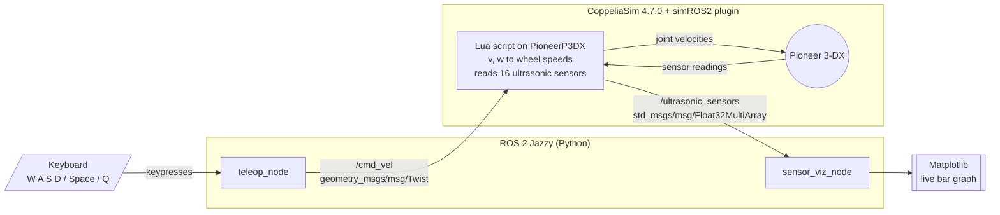

# Pioneer 3-DX Teleoperation and Live Ultrasonic Visualization (ROS 2 Jazzy + CoppeliaSim)

MTR 431: Mobile Robots,
Egypt-Japan University of Science and Technology (E-JUST), Mechatronics and Robotics Engineering
Demo video: [`<YouTube link>`](https://www.youtube.com/watch?v=Vy9o-D6xRLs)

A complete ROS 2 system that drives a simulated **Pioneer 3-DX** in CoppeliaSim with the keyboard and shows its **16 ultrasonic sensors** as a live Matplotlib bar graph.

## Contents

1. [System overview](#1-system-overview)
2. [Repository layout](#2-repository-layout)
3. [Prerequisites](#3-prerequisites)
4. [Install the simROS2 plugin](#4-install-the-simros2-plugin)
5. [Build the ROS 2 packages](#5-build-the-ros-2-packages)
6. [CoppeliaSim scene and Lua script](#6-coppeliasim-scene-and-lua-script)
7. [The two Python nodes](#7-the-two-python-nodes)
8. [Run everything](#8-run-everything)

## 1. System overview



| Topic | Type | Direction |
|---|---|---|
| `/cmd_vel` | `geometry_msgs/msg/Twist` | teleop node to CoppeliaSim |
| `/ultrasonic_sensors` | `std_msgs/msg/Float32MultiArray` (16 values, meters) | CoppeliaSim to visualization node |

## 2. Repository layout

```
.
├── my_teleop_pkg/     # keyboard teleoperation node (teleop_node)
├── sensor_viz/        # live bar-graph node (sensor_viz_node)
├── sim/
│   └── pioneer.ttt    # CoppeliaSim scene (robot, walls, cuboids, Lua script)
└── README.md
```

## 3. Prerequisites

Tested on:

| Component | Version |
|---|---|
| OS | Ubuntu 24.04 |
| ROS 2 | Jazzy |
| CoppeliaSim | 4.7.0 (rev. 4), installed at `/usr/local/CoppeliaSim` |
| Python | 3.12 |

Install the tools needed to build the plugin and run the nodes:

```bash
sudo apt install git xsltproc python3-xmlschema python3-matplotlib python3-colcon-common-extensions
```

Make sure ROS 2 Jazzy is installed and sourced:

```bash
source /opt/ros/jazzy/setup.bash    # use setup.zsh if you use zsh
```

Tell the build where CoppeliaSim lives, and make it permanent:

```bash
export COPPELIASIM_ROOT_DIR=/usr/local/CoppeliaSim
echo 'export COPPELIASIM_ROOT_DIR=/usr/local/CoppeliaSim' >> ~/.bashrc    # or ~/.zshrc
ls $COPPELIASIM_ROOT_DIR/programming    # should list include/, ros2_packages/, ...
```

If CoppeliaSim is installed elsewhere, use that folder (the one containing `coppeliaSim.sh`).

## 4. Install the simROS2 plugin

CoppeliaSim talks to ROS 2 through the **simROS2** plugin, which must be compiled against your ROS 2 distribution.

**4.1 Create a workspace and clone the plugin.** The folder name must be `sim_ros2_interface`.

```bash
mkdir -p ~/pioneer_ws/src && cd ~/pioneer_ws/src
git clone --recursive https://github.com/CoppeliaRobotics/simROS2.git sim_ros2_interface
cd sim_ros2_interface
git checkout coppeliasim-v4.7.0-rev2     # newest plugin tag for CoppeliaSim 4.7.0
git submodule update --init --recursive
```

The plugin repository has no `rev4` tag. `coppeliasim-v4.7.0-rev2` is the latest one for 4.7.0.

**4.2 Make sure the message types we use are compiled in.** Check `meta/interfaces.txt`:

```bash
grep -E "Twist|Float32MultiArray|MultiArrayLayout|MultiArrayDimension" meta/interfaces.txt
```

Add any missing line (full names, one per line, file must end with a newline):

```
geometry_msgs/msg/Twist
std_msgs/msg/Float32MultiArray
std_msgs/msg/MultiArrayLayout
std_msgs/msg/MultiArrayDimension
```

Without this, the Lua script fails with `Unsupported message type 'std_msgs/msg/Float32MultiArray'`.

**4.3 Build the plugin.**

```bash
cd ~/pioneer_ws
source /opt/ros/jazzy/setup.bash
colcon build --symlink-install --packages-select sim_ros2_interface
```

The build takes several minutes and needs a lot of RAM.

**4.4 Verify that CoppeliaSim can see the library.**

```bash
ls -lL /usr/local/CoppeliaSim/libsimROS2.so
```

The build normally places a link to `build/sim_ros2_interface/libsimROS2.so` in the CoppeliaSim folder. If the file is missing, copy it:

```bash
sudo cp ~/pioneer_ws/build/sim_ros2_interface/libsimROS2.so /usr/local/CoppeliaSim/
```

> After the plugin is built once, **do not run a plain `colcon build`** in this workspace. It would try to recompile the plugin every time. Always use `--packages-select` for the packages below.

## 5. Build the ROS 2 packages

Clone this repository into the same workspace and build only its packages:

```bash
cd ~/pioneer_ws/src
git clone https://github.com/desoky5/pioneer3dx-ros2-teleoperation.git
cd ~/pioneer_ws
source /opt/ros/jazzy/setup.bash
colcon build --symlink-install --packages-select my_teleop_pkg sensor_viz
source install/setup.bash
ros2 pkg executables my_teleop_pkg
ros2 pkg executables sensor_viz
```

You should see `teleop_node` and `sensor_viz_node` listed.

## 6. CoppeliaSim scene and Lua script

The scene `sim/pioneer.ttt` contains the Pioneer 3-DX, walls and cuboids to detect, and the Lua script attached to `PioneerP3DX`, which handles `/cmd_vel` and publishes `/ultrasonic_sensors`. No extra setup is needed: open the scene and press Play (section 8).

Keep `maxRange` in the Lua script equal to `MAX_RANGE` in `sensor_viz_node.py` (both 1.0 m).

## 7. The two Python nodes

**`teleop_node`** (`my_teleop_pkg`)

- Publishes `geometry_msgs/msg/Twist` on `/cmd_vel`.
- Reads single keypresses with `termios`/`tty` in raw mode and uses `select` with a 0.1 s timeout, so the loop never blocks.
- A dictionary maps each key to a `(linear, angular)` pair. Defaults are 0.3 m/s and 0.8 rad/s.
- Always publishes a zero velocity and restores the terminal on exit.

**`sensor_viz_node`** (`sensor_viz`)

- Subscribes to `/ultrasonic_sensors`. The callback only stores the latest 16 values (messages with a different length are ignored).
- `rclpy.spin` runs in a background thread, and Matplotlib's `FuncAnimation` runs in the main thread, updating the bar heights every 100 ms with `set_height`.
- The y-axis is fixed at 0 to 1.0 m so the bars do not rescale.

## 8. Run everything

Open three terminals. In **each** of them:

```bash
source /opt/ros/jazzy/setup.bash
source ~/pioneer_ws/install/setup.bash
```

**Terminal 1: CoppeliaSim.** Start it from this sourced terminal, otherwise the ROS plugin cannot find ROS 2.

```bash
/usr/local/CoppeliaSim/coppeliaSim.sh
```

Open `sim/pioneer.ttt` (File, Open scene) and press **Play**. The console should print the robot path, both motor paths and `Sensors found: 16`.

**Terminal 2: visualization node**

```bash
ros2 run sensor_viz sensor_viz_node
```

**Terminal 3: teleoperation node.** Keep this terminal focused while driving.

```bash
ros2 run my_teleop_pkg teleop_node
```

| Key | Action |
|---|---|
| `w` / `s` | forward / backward |
| `a` / `d` | turn left / turn right |
| `space` | stop |
| `q` | quit (publishes a stop first) |

Drive toward the walls and cuboids and watch the bars drop as the robot approaches them.

**Testing the pieces separately**

```bash
ros2 topic list                          # /cmd_vel and /ultrasonic_sensors should appear
ros2 topic echo /ultrasonic_sensors      # 16 values
ros2 topic pub -r 10 /cmd_vel geometry_msgs/msg/Twist "{linear: {x: 0.2}}"    # drives forward without the teleop node
ros2 topic pub -r 5 /ultrasonic_sensors std_msgs/msg/Float32MultiArray \
  "{data: [0.1,0.2,0.3,0.4,0.5,0.6,0.7,0.8,0.9,1.0,0.1,0.2,0.3,0.4,0.5,0.6]}"   # fake data for the plot (stop the simulation first)
```

## Author
 
**`Omar Desoky`**
Mechatronics and Robotics Engineering, Egypt-Japan University of Science and Technology (E-JUST)
 
[](https://github.com/desoky5)
[](https://www.linkedin.com/in/omardesoky5/)
[](mailto:omardsoky05@gmail.com)
